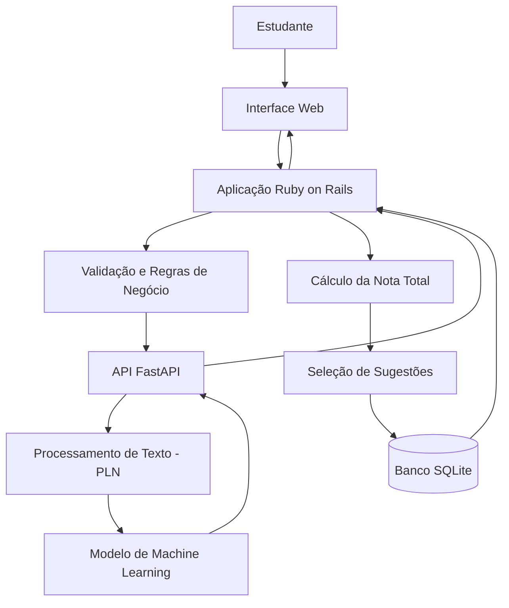

# Arquitetura do Sistema — RedirecionaAI

## 1. Visão geral

O RedirecionaAI utilizará uma arquitetura composta por uma aplicação web principal e um serviço independente responsável pelo processamento textual e pela avaliação automatizada das redações.

A aplicação principal será desenvolvida em Ruby on Rails, enquanto o componente de Inteligência Artificial será desenvolvido em Python e disponibilizado por meio de uma API utilizando FastAPI.

O SQLite será utilizado como banco de dados na primeira versão.

## 2. Tecnologias e responsabilidades

| Tecnologia | Responsabilidade |
|---|---|
| Ruby on Rails | Gerenciar a aplicação web, autenticação, rotas, regras de negócio e histórico dos estudantes. |
| Python | Implementar o processamento textual e o modelo de Machine Learning. |
| FastAPI | Disponibilizar os recursos de avaliação por meio de uma API. |
| SQLite | Armazenar usuários, redações e resultados das avaliações. |
| HTML | Estruturar as páginas da aplicação. |
| CSS | Definir a apresentação visual e a responsividade. |
| JavaScript | Implementar interações necessárias na interface. |

Não será utilizado um framework frontend separado inicialmente. A interface será renderizada pela própria aplicação Rails.

## 3. Organização dos componentes

### 3.1. Aplicação web — Ruby on Rails

Será responsável por:

- Cadastro e autenticação de estudantes.
- Gerenciamento de sessões.
- Recebimento e validação das redações.
- Comunicação com a API de avaliação.
- Cálculo da pontuação total.
- Seleção das sugestões predefinidas de melhoria.
- Armazenamento e consulta do histórico.
- Apresentação dos resultados na interface.

### 3.2. Serviço de avaliação — Python e FastAPI

Será responsável por:

- Receber o texto encaminhado pela aplicação Rails.
- Realizar o pré-processamento textual.
- Extrair características utilizando técnicas de Processamento de Linguagem Natural.
- Executar o modelo de Machine Learning supervisionado.
- Retornar as pontuações estimadas das competências avaliadas.

O serviço deverá retornar uma resposta estruturada para que a aplicação Rails consiga interpretar os resultados.

### 3.3. Banco de dados — SQLite

Será utilizado para persistir os dados necessários ao funcionamento da aplicação, incluindo:

- Informações dos estudantes.
- Redações enviadas.
- Resultados das avaliações.
- Pontuações estimadas por competência.
- Pontuação total.
- Datas e informações necessárias para o histórico.

## 4. Fluxo de funcionamento

O fluxo principal de avaliação seguirá esta sequência:

1. O estudante acessa a aplicação web e realiza o login.
2. O estudante digita ou cola sua redação.
3. O Rails valida o conteúdo enviado.
4. O Rails encaminha o texto para a API FastAPI.
5. O serviço Python realiza o processamento textual.
6. O modelo de Machine Learning gera as estimativas de pontuação.
7. A API retorna os resultados ao Rails.
8. O Rails calcula a pontuação total e seleciona as sugestões predefinidas.
9. A aplicação armazena a redação e os resultados no SQLite.
10. O estudante visualiza a avaliação na interface.

## 5. Representação da arquitetura

## 6. Modelo de Machine Learning

O projeto utilizará aprendizado supervisionado para estimar o desempenho de uma redação nas cinco competências do ENEM.

A proposta inicial consiste em utilizar uma base de dados de redações previamente avaliadas, com suas respectivas pontuações.

O processamento será realizado em etapas:

1. Coleta e análise da base de dados.
2. Verificação da licença e das condições de utilização.
3. Limpeza e preparação dos textos.
4. Extração de características por meio de técnicas de PLN.
5. Separação dos dados em conjuntos de treinamento e avaliação.
6. Treinamento do modelo supervisionado.
7. Avaliação dos resultados por competência.
8. Integração do modelo com a API FastAPI.

### 6.1. Escolha do algoritmo

O algoritmo de Machine Learning ainda não está definido.

A escolha será feita após a análise dos dados disponíveis, considerando a qualidade da base, a natureza das pontuações e o desempenho dos modelos testados.

### 6.2. Validação do modelo

O modelo deverá ser avaliado com dados que não tenham participado do treinamento.

Serão utilizadas métricas adequadas ao tipo de previsão realizada, com resultados documentados individualmente para cada competência.

A apresentação das cinco pontuações dependerá da validação satisfatória do modelo para todas elas.

## 7. Estratégia de orientação ao estudante

O RedirecionaAI não utilizará modelos de linguagem generativa externos na primeira versão.

As orientações serão produzidas por meio de mensagens previamente elaboradas e selecionadas de acordo com os resultados da avaliação e as características identificadas no texto.

Essa abordagem mantém a proposta inicial mais simples e reduz a dependência de serviços externos.

## 8. Considerações técnicas

A separação entre Rails e Python permite que cada componente tenha uma responsabilidade bem definida.

O Rails concentra a lógica da aplicação e o gerenciamento dos estudantes, enquanto o Python fica responsável pelas operações relacionadas ao processamento textual e ao modelo de Machine Learning.

A utilização do FastAPI permite estabelecer uma comunicação entre os dois componentes por meio de requisições HTTP.

O SQLite atende à proposta inicial de persistência, mantendo a infraestrutura simples durante as primeiras etapas do desenvolvimento.

As tecnologias e decisões arquiteturais poderão ser revisadas conforme as necessidades identificadas durante a implementação.